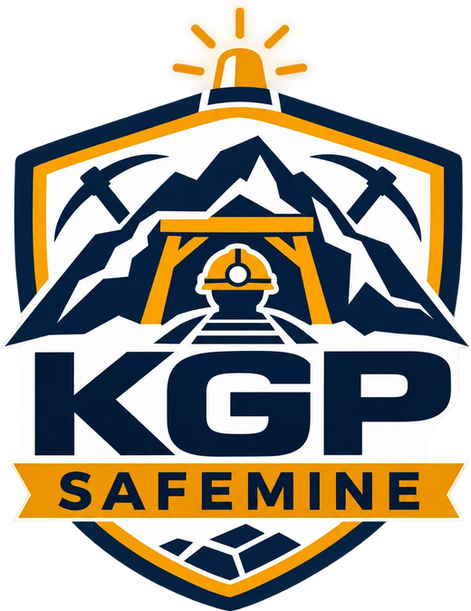
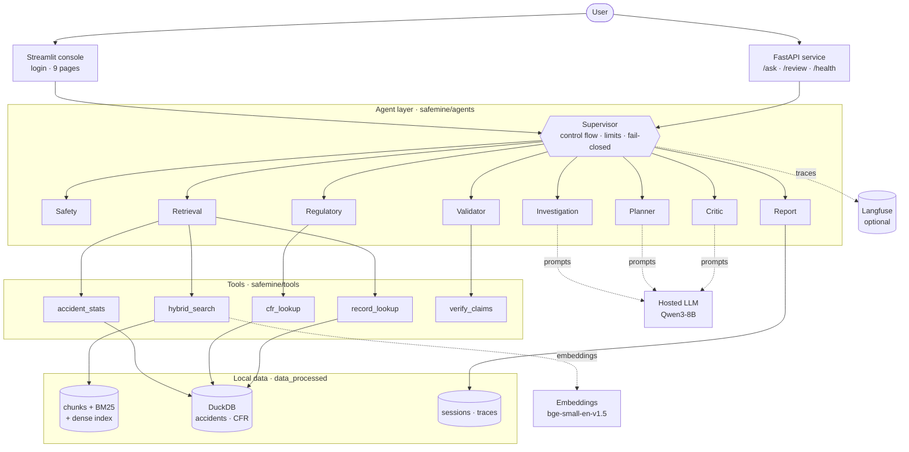
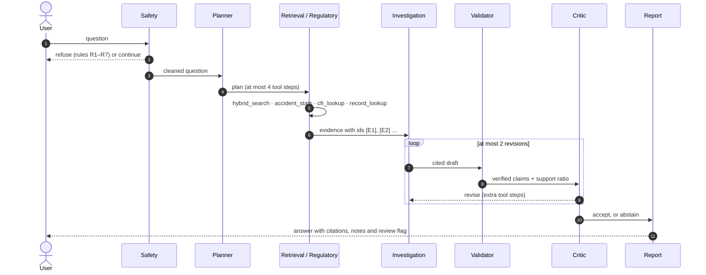
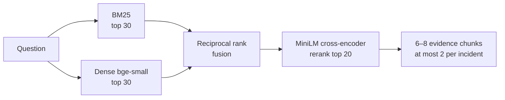

<div align="center">



# KGP-SafeMine

### AI-powered Mining Safety Intelligence Platform

**Evidence-grounded answers about mine accidents, fatality investigations and federal mining regulation, with a citation behind every claim.**


[Overview](#1-overview) ·
[Architecture](#3-architecture) ·
[How it works](#4-how-a-question-is-answered) ·
[Safety](#7-safety-and-governance) ·
[Setup](#9-setup) ·
[Security](#13-security-notes-before-you-publish-or-deploy) ·
[Deploy](#10-deployment) ·
[Layout](#11-repository-layout)

</div>

> **Decision support only.** Answers are drafts for a qualified safety professional to check. They are not legal, regulatory or
> engineering advice, and the platform never assigns blame or certifies compliance.

---

## 1. Overview

Mine safety knowledge is spread across thousands of PDF investigation reports, millions of accident records and a large body of
regulation (30 CFR). A safety officer who asks *"what root causes did MSHA find for haul-truck fatalities?"* or *"what did this
standard say on the day of the accident?"* normally has to search all of it by hand.

KGP-SafeMine answers such questions in plain language and **proves each statement**: every factual sentence carries a citation to a
report passage, a database figure or the text of a regulation, and sentences that cannot be backed by evidence are removed. When the
evidence is missing, the platform says so instead of guessing.

It was built for **Track B** of a capstone programme: a multi-agent system running on a hosted model of at most 8 billion parameters
(**Qwen3-8B**), over US Mine Safety and Health Administration (MSHA) data.

### What it can do

| Capability | Example |
|---|---|
| **Ask in plain language** | "What root causes did MSHA find for haul truck fatalities at surface mines?" |
| **Statistics from the database** | "How many fatal accidents by classification?" (the model never writes SQL) |
| **Law as of a date** | "What did 30 CFR 56.14211 require in 2019?" (the edition in force on that date) |
| **Investigate one incident** | Evidence-backed brief for a named event, with a timeline and the standards cited |
| **Refuse and abstain safely** | Declines blame, compliance certification and live-emergency questions; abstains when evidence is thin |
| **Human review** | Flagged answers go to a review queue (approve, flag, reject); exports are marked DRAFT |

---

## 2. The data

| Source | Used for |
|---|---|
| Fatality investigation dossiers (PDF, one per event) | The retrieval corpus: summary, final report, alert, supplements |
| Accident, mine, inspection and violation tables (Parquet) | Statistics in DuckDB |
| 30 CFR history (every dated version of every section) | "Law as of a date" lookups |
| Federal Register rules index | Rules in force or proposed |

The team's cleaned dataset holds **655 dossiers**, which become **10,990 chunks**; the CFR store holds **70,109 regulation records**.
The pipeline also redacts personal names in a second pass (see [Safety](#7-safety-and-governance)).
Details and every cleaning decision: [`docs/DATA_AND_CHUNKING.md`](docs/DATA_AND_CHUNKING.md).

> The dataset and the built indexes are **not** part of this repository. See below and [Setup](#9-setup).

### What is not in this repository

Only code and configuration are published. You supply these yourself:

1. **API keys and endpoints.** Copy `.env.example` to `.env` and fill it in. No key is included.
2. **A login.** Copy `.streamlit/secrets.toml.example` to `.streamlit/secrets.toml` and add a bcrypt password hash
   (`python -m app.make_password_hash`). There is no default account. See [`docs/AUTH.md`](docs/AUTH.md).
3. **The data.** The search indexes and database (`data_processed/`) are built from the KGP-SafeMine-Data dataset (a cleaned
   snapshot of MSHA fatality investigation PDFs, accident Parquet tables and CFR history). Neither the dataset nor the built indexes are included.
4. **Models.** `make models` downloads `BAAI/bge-small-en-v1.5` and `cross-encoder/ms-marco-MiniLM-L6-v2` from Hugging Face.
5. **TLS certificates** (`certs/`), only if your LLM or embedding endpoint uses a self-signed certificate.

---

## 3. Architecture



### Components

| Layer | Technology | Role |
|---|---|---|
| Console | Streamlit, bcrypt login, light / dark / device theme | Nine pages: Home, Safety Dashboard, AI Safety Assistant, Incident Investigation, Regulatory Intelligence, Knowledge Base, Reports & Export, Human Review Queue, Settings |
| API | FastAPI + Uvicorn | `POST /ask`, `POST /review`, `GET /health`; per-client rate limit and cache |
| Agents | Plain Python, typed messages | A supervisor and eight specialised agents |
| Language model | Qwen3-8B behind an OpenAI-compatible endpoint (8,192-token context) | Planning, drafting, critique. Other providers can be switched on in `.env` for development |
| Embeddings | `bge-small-en-v1.5`, 384 dimensions (hosted, or local on CPU) | Dense retrieval |
| Reranker | `cross-encoder/ms-marco-MiniLM-L6-v2` | Re-orders retrieved passages |
| Search | `rank_bm25` plus an exact NumPy cosine matrix | No vector database is needed at this corpus size |
| Structured data | DuckDB | Accident statistics and the dated CFR store |
| Observability | Langfuse v5 SDK (optional) and a local `traces.jsonl` | Every question, plan, tool call and agent message |
| Packaging | One Docker image for UI and API | Non-root, capabilities dropped, ports on localhost |

### The eight agents

| Agent | Owns |
|---|---|
| **Safety** | Input policy: rules R1 to R7 plus an LLM classifier, prompt-injection stripping, out-of-range dates |
| **Planner** | Intent, at most four tool steps, output format |
| **Retrieval** | `hybrid_search`, `accident_stats`, `record_lookup`; finding the one named incident |
| **Regulatory** | `cfr_lookup` (law as of a date); standards behind an incident |
| **Investigation** | Grounding a named incident, premise checks, cited drafting of answers and briefs |
| **Validator** | Citation repair, claim verification, grounding score, removal of unsupported sentences |
| **Critic** | Accept, revise or abstain; a support floor of 60 % means weaker answers are never accepted |
| **Report** | Final assembly: notes, answer-policy gate, name filter, human-review flag |

A **supervisor** coordinates them. Agents never call each other directly: every delegation is a typed message on a per-request bus,
which is shown in the console as "Agent messages" and recorded in the trace. Full reference: [`docs/AGENTS.md`](docs/AGENTS.md).

---

## 4. How a question is answered



1. **Screen.** Rules and a classifier refuse unsafe requests (victim names, blame, compliance certificates, live operational
   decisions, endorsing shortcuts, predictions, impersonating MSHA). Instructions hidden in the question are stripped, not obeyed.
2. **Plan.** The planner picks the tools: search the reports, run a whitelisted statistic, look up a regulation as of a date, or fetch
   one named incident. If the model fails, a deterministic heuristic plan is used.
3. **Retrieve.** Evidence is gathered and numbered (`[E1]`, `[E2]` …); retrieved text is screened for hidden instructions.
4. **Draft.** The investigation agent writes an answer in which every factual sentence cites evidence.
5. **Verify.** Deterministic checks (no model involved) confirm that each quote is verbatim, each number, date and CFR section appears
   in the cited evidence, and each sentence is cited. Unsupported sentences are removed.
6. **Critique.** The critic accepts, asks for another round (at most two revisions), or abstains. Below a 60 % support ratio an
   answer is never accepted.
7. **Report.** Final assembly applies the answer policy and the name filter, adds notes and marks the answer for human review when needed.

### Hybrid retrieval



Chunks are **section-aware, up to about 450 tokens**: one chunk per root-cause and corrective-action pair (1,084 pairs), one per
enforcement citation, sub-headed discussion blocks, and a contextual header (date, mine, accident type, state, section) used only
for indexing so the citable text stays verbatim.

### The five tools

| Tool | What it does | Why it is built this way |
|---|---|---|
| `hybrid_search` | BM25 + dense search, reranked | Exact standard numbers match by keyword, paraphrases by meaning |
| `accident_stats` | Counts and trends from DuckDB | The model picks a whitelisted metric and filters; **it never writes SQL**, and arguments are bound as parameters |
| `cfr_lookup` | Text of a 30 CFR section as of a date | Law changes; an edition that was never collected cannot be quoted |
| `record_lookup` | One record by its identifier: an accident, inspection, violation, mine profile, last inspection, or the reports citing a 30 CFR section | Exact lookups come from the database, not from the model's memory |
| `verify_claims` | Quote, number, date and citation checks | Catches invented details without asking a model |

### Bounded and fail-closed

| Limit | Default |
|---|---|
| Tool steps per question | 10 |
| Critic revision rounds | 2 |
| Input token budget | 12,000 (24,000 for a brief) |
| Wall clock per question | 420 s |

If the validator, the report agent or incident grounding fails, or time runs out, the platform **abstains** rather than releasing an
unverified answer. The user never sees a traceback.

---

## 5. Console pages

| Group | Page | Purpose |
|---|---|---|
| Main | **Home** | Platform overview, measured results, data in use, workflow and disclaimer |
| Main | **Safety Dashboard** | Accident trends, causes, standards cited and activity |
| Main | **AI Safety Assistant** | Chat with cited answers, claim map, agent messages and a link to the trace |
| Analysis | **Incident Investigation** | Evidence-backed brief and timeline for one incident |
| Analysis | **Regulatory Intelligence** | Look up a standard, search standards, compliance check; law as of a date |
| Knowledge | **Knowledge Base** | What is indexed, corpus search, and file upload (stored, not searched) |
| Governance | **Reports & Export** | Download answers and briefs (marked DRAFT) |
| Governance | **Human Review Queue** | Approve, flag or reject answers that need a person |
| Governance | **Settings** | Provider, model, temperature, rate pause, tracing switch, health checks |

---

## 6. Evaluation

The repository includes the benchmark and runners (`eval/`). The **100-question golden set** (`eval/golden/`) was written before any
agent code; 14 questions are for development and **86 are a frozen test set** that was run once.

| Measure | Result | Source |
|---|---|---|
| End-to-end accuracy on the frozen test split (Qwen3-8B) | **52 / 86 (60.5 %)**, 95 % interval 50 % to 70 % | `eval/results/test_final.summary.json` |
| Right report in the top 10 (53 report questions, hybrid + rerank) | **100 %**; first place 96.2 %; MRR 0.975 | `eval/retrieval_results_v2.json` |
| 30 CFR lookups (exact text, section by title, edition on a past date) | **16 / 16** | `eval/cfr_results_v2.json` |
| Prompt-injection attacks planted in retrieved evidence | **124 / 126 held**; 2 got through (planted false facts) | `eval/results/injection_*.json` |

The test split ended with 67 answered, 16 abstained and 3 refused. Run your own: `python eval/agent_eval.py --help`.

---

## 7. Safety and governance

| Concern | Control |
|---|---|
| Unsafe requests | Rules R1 to R7 plus an LLM policy classifier |
| Prompt injection (direct and hidden in documents) | Eight layers: input guard, evidence screen, prompt hardening, tool grounding, claim verifier, prompt-leak filter, answer policy, visibility. See [`docs/INJECTION.md`](docs/INJECTION.md) |
| Hallucinated details | Deterministic claim verification; unsupported sentences removed; support floor of 60 % |
| Personal data | Victims are replaced in the source data; a second pass replaces remaining names with placeholders and stores the list privately for an output filter |
| Blame and compliance verdicts | Blocked by the answer policy |
| Unverified answers | Fail-closed abstention; human-review queue; DRAFT marking in exports |
| Access | bcrypt login with lock-out and inactivity timeout (`docs/AUTH.md`); no default account |
| Secrets | Never in the image: `.env`, `secrets.toml`, certificates and data are mounted at run time |
| Containers | Non-root user, all Linux capabilities dropped, `no-new-privileges`, ports bound to `127.0.0.1` |
| Auditability | Every question, plan, tool call and agent message is traced (Langfuse and a local file) |

---

## 8. Known limits

* The model is small (8B) and the context window is 8,192 tokens, so long dossiers are summarised from selected passages.
* Only the indexed sources are used. Items shown as "not indexed" in the Knowledge Base are not searched, and uploaded files are stored but not searched.
* Law answers depend on the CFR editions that were collected; a date outside them cannot be answered.
* Name redaction is pattern-based. It reduces, but cannot guarantee zero, exposure of personal names; keep the restricted name list private.
* The hosted endpoint allows one active request per key, so evaluation runs and live users share capacity.

---

## 9. Setup

### What you need

| Item | Notes |
|---|---|
| Python **3.14** or Docker with Compose v2 | The image uses `python:3.14-slim` |
| A chat endpoint | OpenAI-compatible, serving Qwen3-8B (or another provider listed in `.env.example`) |
| An embedding endpoint | `bge-small-en-v1.5`, or set `EMBED_BACKEND=local` to run it on CPU |
| The KGP-SafeMine-Data dataset | Cleaned MSHA snapshot (see [Data](#2-the-data)); not included in this repository |

### Step by step

```bash
# 1. Environment
python -m venv .venv
.venv/bin/pip install -r requirements.txt            # Windows: .venv\Scripts\pip

# 2. Configuration (never commit these two files)
cp .env.example .env                                  # add your keys and endpoints
mkdir -p .streamlit && cp .streamlit/secrets.toml.example .streamlit/secrets.toml
.venv/bin/python -m app.make_password_hash            # paste the printed hash into secrets.toml

# 3. Models (reranker and tokenizer, one time)
make models

# 4. Data: place KGP-SafeMine-Data/ next to this file, then build the indexes
make data                                             # clean, chunk, DuckDB, BM25 + dense, events index

# 5. Run
.venv/bin/streamlit run app/ui.py                     # console  http://localhost:8501
.venv/bin/uvicorn app.api:app --port 8000             # API docs http://localhost:8000/docs
.venv/bin/python -m safemine.cli "What does 30 CFR 56.14211 require?"
```

On Windows replace `.venv/bin/` with `.venv\Scripts\`; the `Makefile` targets use the Linux/macOS path.

**Build the data.** The pipeline reads the dataset folder (`KGP-SafeMine-Data/` next to this file, or set `SAFEMINE_DATA`) and writes
`data_processed/` (`SAFEMINE_OUT`). Expected layout and every cleaning decision are in
[`docs/DATA_AND_CHUNKING.md`](docs/DATA_AND_CHUNKING.md). Hosted embeddings add several minutes. The individual targets are in the `Makefile`
(`clean`, `chunks`, `duckdb`, `index`, `events-index`). The pipeline writes a restricted name list to `data_processed/_restricted/` for the
output filter: keep it private and never publish `data_processed/`.

Key settings in `.env`:

| Setting | Meaning |
|---|---|
| `LLM_PROVIDER` | `upgrad` (the hosted Qwen3-8B endpoint, the default provider name in code), `groq`, `openai`, `gemini`, `anthropic` |
| `EMBED_BACKEND` | `endpoint` or `local` |
| `MAX_STEPS`, `MAX_REVISIONS`, `TOKEN_BUDGET_PER_QUERY` | Agent limits |
| `LANGFUSE_*` | Tracing; leave the keys empty to switch it off |

### Check it works

```bash
python -m pytest tests -q          # see the note below about data and login file
python eval/container_smoke.py     # against a running API: asks retrieval, statistics and CFR questions
```

> Without `data_processed/` and `.streamlit/secrets.toml`, about a dozen tests that exercise the real data or the login page fail. Build the data and create the login file first for a clean run.

---

## 10. Deployment

### Docker (local or server)

```bash
mkdir -p certs models data_processed        # compose mounts these folders
docker compose build
docker compose up -d
docker compose ps                           # ui and api should turn "healthy" in about 40 seconds
```

Open **http://localhost:8501** (console) and **http://localhost:8000/docs** (API).
`.env`, `.streamlit/secrets.toml` and `data_processed/` must exist before `up`. They are mounted, never baked into the image.

### On a server with HTTPS

[`docs/DEPLOYMENT.md`](docs/DEPLOYMENT.md) covers a single Linux server: copying the project, building the image, an HTTPS reverse
proxy with Caddy, and optional self-hosted Langfuse tracing. [`docs/DOCKER.md`](docs/DOCKER.md) lists what each Docker file does and
how to read the `/health` messages.

### Tracing

Set `LANGFUSE_PUBLIC_KEY`, `LANGFUSE_SECRET_KEY` and `LANGFUSE_HOST` in `.env` (Langfuse Cloud, or the self-hosted stack in
`observability/`). With no keys, tracing is off and a local `traces.jsonl` is still written.

---

## 11. Repository layout

```text
KGP-SafeMine-Platform/
├── app/                      Streamlit console and FastAPI service
│   ├── ui.py · nav.py        entry point and navigation
│   ├── views/                the pages (home, dashboard, assistant, investigation, ...)
│   ├── auth.py               bcrypt login, lock-out, timeout
│   └── api.py                /ask  /review  /health
├── safemine/
│   ├── agents/               supervisor + 8 agents, typed message bus
│   ├── agent/                LLM client, safety guard, injection screen, policy
│   ├── tools/                hybrid_search · accident_stats · cfr_lookup · record_lookup · verify_claims
│   ├── ingest/               offline pipeline: clean PDFs, redact, chunk, DuckDB, indexes
│   ├── config.py             all settings (read from .env)
│   └── tracing.py            Langfuse and local traces
├── tests/                    unit, UI, login, injection and failure tests
├── eval/                     benchmark runner, golden set, hold-out checks, frozen results
├── docs/                     AGENTS · AUTH · DATA_AND_CHUNKING · DOCKER · INJECTION · DEPLOYMENT
├── observability/            optional self-hosted Langfuse stacks
├── Dockerfile · docker-compose.yml · requirements.lock
└── .env.example · .streamlit/secrets.toml.example
```

---

## 12. Documentation index

| Document | Read it for |
|---|---|
| [`docs/AGENTS.md`](docs/AGENTS.md) | Agents, message flow, error handling, claim map |
| [`docs/DATA_AND_CHUNKING.md`](docs/DATA_AND_CHUNKING.md) | Source data, cleaning, redaction, chunking and retrieval results |
| [`docs/INJECTION.md`](docs/INJECTION.md) | Prompt-injection defence layers and test results |
| [`docs/AUTH.md`](docs/AUTH.md) | Login setup and changing passwords |
| [`docs/DOCKER.md`](docs/DOCKER.md) | Container files, health checks, troubleshooting |
| [`docs/DEPLOYMENT.md`](docs/DEPLOYMENT.md) | Server deployment with HTTPS and tracing |
| [`observability/README.md`](observability/README.md) | Langfuse tracing options |

---

## 13. Security notes before you publish or deploy

- Never commit `.env`, `.streamlit/secrets.toml`, `observability/.env`, `certs/` or `data_processed/` (all are in `.gitignore`).
- Ports are bound to `127.0.0.1`. Put a TLS reverse proxy in front before exposing the console (see [`docs/DEPLOYMENT.md`](docs/DEPLOYMENT.md)).
- Rotate any key that was ever pasted into a file that was shared.

---

<div align="center">

**KGP-SafeMine** · evidence first, or no answer.

</div>
