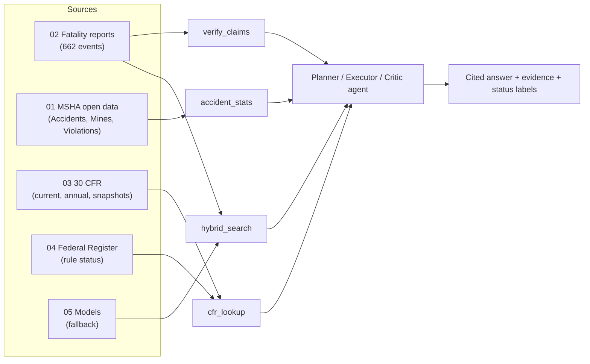

# KGP-SafeMine_Data

**US mining-industry data for the KGP-SafeMine agent** (IIT Kharagpur GenAI and Agentic AI Capstone, Track B).

-1f4e79)   

This folder holds every public data source the agent needs: incident reports, structured accident and violation records, the law that applied, rule status, reference documents and local fallback models. All numbers in this file were **measured from the files on disk**, not copied from the project blueprint.

## Contents

1. [Overview](#1-overview)
2. [Repository layout](#2-repository-layout)
3. [How the data feeds the agent](#3-how-the-data-feeds-the-agent)
4. [Folder reference](#4-folder-reference)
   - [4.1 `00_links`](#41-00_links)
   - [4.2 `01_msha_datasets`](#42-01_msha_datasets)
   - [4.3 `02_fatality_reports`](#43-02_fatality_reports)
   - [4.4 `03_cfr_ecfr`](#44-03_cfr_ecfr)
   - [4.5 `04_reference_sources`](#45-04_reference_sources)
   - [4.6 `05_models`](#46-05_models)
5. [Quick start](#5-quick-start)
6. [Verification results](#6-verification-results)
7. [Known limitations and what is still missing](#7-known-limitations-and-what-is-still-missing)
8. [Licence, privacy and ethics](#8-licence-privacy-and-ethics)
9. [Using this folder on GitHub](#9-using-this-folder-on-github)
10. [Corrections to the blueprint](#10-corrections-to-the-blueprint)

---

## 1. Overview

| | |
|---|---|
| **Goal** | Turn a mining incident description or question into a cited, regulation-aware analysis that a safety professional reviews. Decision support only. |
| **Jurisdiction** | United States only. All India (DGMS) and Australian material was removed. |
| **Source** | US Department of Labor, Mine Safety and Health Administration (MSHA), plus eCFR, GovInfo, the Federal Register, BLS and OWASP |
| **Collected** | 3-4 Nov 2026, by script, one request at a time with a descriptive User-Agent |
| **MSHA bulk files** | Last modified **Fri 30 Oct 2026**. MSHA refreshes them every Friday, so treat this copy as the frozen snapshot and do not re-download after the benchmark freeze. |
| **Total size** | 2.5 GB in 6,887 files |

### Key facts

| Fact | Value |
|---|---|
| Fatality events with MSHA reports (2008-2026) | **662** |
| Events with a final investigation report | **605** (91%) |
| Report pages saved (HTML) / PDFs saved | 2,793 / 1,820 |
| Accident rows 2000-2026 | 275,673 (of which fatal: 1,218 rows, 1,127 mine-days) |
| Violations 1994-2026 | 3,110,622 |
| Final reports that join to an Accidents row | **99.7%** (617 of 619) |
| MSHA final rules / proposed rules in Federal Register metadata | 173 / 227 |
| Annual CFR Title 30 editions | 18 (2008-2025) |

## 2. Repository layout

```text
KGP-SafeMine_Data/
|-- README.md                      this file
|-- 00_links/                      link list, download manifest, checksums        (11 files)
|-- 01_msha_datasets/              MSHA open data (structured layer)               (50 files, 589 MB)
|   |-- *.zip, *_Definition_File.txt   core five data sets + dictionaries
|   `-- more_datasets/                 15 further MSHA data sets + definitions/
|-- 02_fatality_reports/           MSHA fatality reports (primary RAG corpus)      (6,502 files, 1.4 GB)
|   |-- search_pages/                  raw search-result pages
|   |-- event_urls.json                all report URLs
|   |-- html/<year>/<event>/           event, preliminary, alert, final report, notice
|   |-- pdf/<year>/<event>/            report PDFs
|   `-- pre2008_optional/              1995-2007 archive (optional)
|-- 03_cfr_ecfr/                   30 CFR text and history                         (132 files, 100 MB)
|   |-- part_*_2026-10-30.xml          current text, core parts
|   |-- chapter1_all_parts/            every MSHA Chapter I part, current
|   |-- annual_editions/               official annual CFR volumes 2008-2025
|   |-- ecfr_snapshots/                exact-date snapshots, Parts 50/56/57/75/77
|   `-- versions_part_*.json           amendment history per part
|-- 04_reference_sources/          rules, policy, disaster reports, statistics     (149 files, 209 MB)
`-- 05_models/                     local embedding and reranker models             (42 files, 216 MB)
```

## 3. How the data feeds the agent



| Agent component (blueprint section) | Data source |
|---|---|
| Retrieval corpus for arms B, C, D (S4, S8) | `02_fatality_reports/html/**/final-report.html`: one event = one document, report sections = chunks |
| `hybrid_search` tool | The same corpus, plus fatal accident rows and CFR sections as short documents |
| `accident_stats` tool | `01_msha_datasets`: Accidents, Mines, Violations, Inspections, MinesProdYearly |
| `cfr_lookup` tool, law at incident date | `03_cfr_ecfr`: annual editions 2008-2025, exact snapshots 2017+, current text, Chapter I parts |
| In force / Proposed / Stayed tags | `04_reference_sources/federal_register_msha/` and the silica stay notice |
| Gold answers (S7) | Root Cause, Corrective Action, Conclusion and Enforcement sections of final reports; standards cited |
| Held-out recent slice (D10) | Reports dated 2025-2026 (27 + 10 final reports) |
| `verify_claims` quote check | The stored report text itself |
| Prompt-injection test design | `04_reference_sources/owasp/` |
| Licence and PII rules (S4.6) | `04_reference_sources/dol.gov/copyright.html`; redact victim names |
| Output template (S5) | `04_reference_sources/msha.gov/PH20-I-4_...pdf` and the report structure |
| Embedding and reranker fallback | `05_models/` |

## 4. Folder reference

### 4.1 `00_links`

| File | Content |
|---|---|
| `blueprint_links.csv` | The 48 URLs found in the blueprint, with the blueprint line each came from |
| `download_manifest_all.csv` | One row per file or request: stage, URL, local path, HTTP status, bytes, SHA-256, Last-Modified, retrieval time. Matches what is on disk. |
| `SHA256SUMS_all.txt` | Checksums for every stored file, in `sha256sum -c` format |
| `download_manifest_pass*.csv`, `SHA256SUMS*.txt` | Raw per-pass logs, superseded by the `_all` files |

One URL was deliberately **excluded**: the MSHA Academy fatality archive. It lists victim names, and blueprint S4.6 says never to ingest it. The manifest records the skip.

Verify the files from the data folder:

```bash
sha256sum -c 00_links/SHA256SUMS_all.txt
```

### 4.2 `01_msha_datasets`

MSHA Open Government Data. Each zip holds one pipe-delimited text file; **fields are double-quoted**. Definition files describe every column.

#### Core five (used by the blueprint)

| Data set | Rows | Fields | Zip | Years | Role |
|---|---|---|---|---|---|
| `Accidents.zip` | 275,673 | 57 | 49.9 MB | 2000-2026 | Outcome label, equipment, activity, classification, occupation, narrative |
| `Mines.zip` | 92,101 | 59 | 7.0 MB | current | Mine type, state, status, coordinates, employees |
| `Violations.zip` | 3,110,622 | 61 | 115.4 MB | 1994-2026 | Citations and the standard cited (`PART_SECTION`) |
| `Inspections.zip` | 1,164,046 | 45 | 70.4 MB | - | Inspection events, hours, sample counts |
| `MinesProdYearly.zip` | 658,945 | 11 | 6.7 MB | - | Hours and employment per mine-year, for injury rates |

#### Key columns

| Data set | Columns the agent will use |
|---|---|
| **Accidents** | `MINE_ID`, `DOCUMENT_NO`, `ACCIDENT_DT` (`MM/DD/YYYY`), `DEGREE_INJURY_CD` (`01` = fatal), `CLASSIFICATION`, `ACCIDENT_TYPE`, `MINING_EQUIP`, `ACTIVITY`, `OCCUPATION`, `INJURY_SOURCE`, `NATURE_INJURY`, `TOT_EXPER`, `COAL_METAL_IND`, `NARRATIVE` |
| **Mines** | `MINE_ID`, `CURRENT_MINE_NAME`, `COAL_METAL_IND`, `CURRENT_MINE_TYPE`, `CURRENT_MINE_STATUS`, `STATE`, `FIPS_CNTY_NM`, `NO_EMPLOYEES`, `LATITUDE`, `LONGITUDE` |
| **Violations** | `MINE_ID`, `VIOLATION_NO`, `VIOLATION_ISSUE_DT`, `PART_SECTION`, `SECTION_OF_ACT`, `SIG_SUB`, `LIKELIHOOD`, `NEGLIGENCE`, `PROPOSED_PENALTY`, `CONTESTED_IND` |
| **Inspections** | `EVENT_NO`, `MINE_ID`, `INSPECTION_BEGIN_DT`, `ACTIVITY`, `NBR_INSPECTOR`, `SUM(TOTAL_INSP_HOURS)` |
| **MinesProdYearly** | `MINE_ID`, `CALENDAR_YR`, `ANNUAL_HRS`, `AVG_ANNUAL_EMPL`, `C_M_IND` |

**Join keys:** `MINE_ID` is a 7-character string in every file (for example `2102843`). Accident rows and violations join to `Mines` on `MINE_ID`.

#### Example record (Accidents, fatal, 2024)

| Field | Value |
|---|---|
| `MINE_ID` | `0504841` |
| `ACCIDENT_DT` | `04/15/2024` |
| `CLASSIFICATION` | POWERED HAULAGE |
| `ACTIVITY` | Machine maintenance |
| `NARRATIVE` | Employee was fatally injured while working on a conveyor system. |

#### Extra data sets (`more_datasets/`)

Real US MSHA data that the blueprint does not use. Keep for deeper analysis and ignore for the MVP. `15` zips, 12,694,767 rows in total.

| Data set | Rows | Zip | Content |
|---|---|---|---|
| `AddressofRecord.zip` | 91,805 | 3.5 MB | Mailing addresses of record for mines and operators |
| `AreaSamples.zip` | 8,879 | 0.2 MB | Area air-sample results |
| `AssessedViolations.zip` | 3,044,111 | 104.6 MB | Penalty assessments per violation |
| `CivilPenaltyDocketsDecisions.zip` | 483,244 | 13.7 MB | Civil-penalty dockets and decisions on contested penalties |
| `CoalDustSamples.zip` | 3,041,434 | 103.7 MB | Respirable coal dust samples |
| `Conferences.zip` | 162,566 | 1.0 MB | Safety and health conference records |
| `ContestedViolations.zip` | 453,342 | 24.1 MB | Violations contested by operators |
| `ContractorProdQuarterly.zip` | 1,363,017 | 9.1 MB | Contractor hours and production by quarter |
| `ContractorProdYearly.zip` | 281,439 | 3.1 MB | Contractor hours and production by year |
| `ControllerOperatorHistory.zip` | 170,308 | 4.3 MB | Ownership and operator history per mine |
| `MinesProdQuarterly.zip` | 2,761,707 | 51.4 MB | Mine hours, employment and production by quarter |
| `NoiseSamples.zip` | 277,264 | 6.1 MB | Noise exposure samples |
| `OrdersIssued.zip` | 3,881 | 0.2 MB | 107(a) imminent-danger orders (small CSV) |
| `PersonalHealthSamples.zip` | 318,281 | 5.9 MB | Personal exposure samples |
| `QuartzSamples.zip` | 233,489 | 8.0 MB | Respirable quartz samples |

`more_datasets/definitions/` and the `*_Definition_File.txt` files hold 29 data dictionaries. `OGIMSHA_dataset_list.html` is MSHA's own list of data sets. `DustData-1986-2016.zip` is advertised there but returns HTTP 404, so it could not be collected.

**Verified:** all 20 zips pass the integrity test. 100.0% of Accidents mine ids and 100.0% of Violations mine ids exist in `Mines`. Accidents narratives run up to **610 characters** (mean 189).

### 4.3 `02_fatality_reports`

The primary RAG corpus: MSHA's fatality investigation pages, 2008-2026.

| Path | Content |
|---|---|
| `search_pages/` | 24 raw search-result pages (listing metadata: mine, state, classification) |
| `event_urls.json` | All 2,793 report URLs found |
| `html/<year>/<event>/` | `event.html`, `preliminary-report.html`, `fatality-alert.html`, `final-report.html`, `public-notice.html` where they exist |
| `pdf/<year>/<event>/` | Report PDFs linked from those pages (1,820 of 1,822 fetched, 1,140 MB, corrupt: 0) |

**Document types:** event 662, fatality-alert 607, final-report 605, preliminary-report 519, public-notice 338. Some event folders carry a `-0` or `-1` suffix for same-day multiples.

#### Events and final reports per year

| Year | Events | With final report | Without |
|---|---|---|---|
| 2008 | 53 | 52 | 1 |
| 2009 | 37 | 35 | 2 |
| 2010 | 43 | 42 | 1 |
| 2011 | 38 | 35 | 3 |
| 2012 | 37 | 36 | 1 |
| 2013 | 42 | 41 | 1 |
| 2014 | 44 | 43 | 1 |
| 2015 | 29 | 29 | 0 |
| 2016 | 25 | 23 | 2 |
| 2017 | 27 | 27 | 0 |
| 2018 | 29 | 28 | 1 |
| 2019 | 28 | 26 | 2 |
| 2020 | 30 | 26 | 4 |
| 2021 | 37 | 36 | 1 |
| 2022 | 32 | 28 | 4 |
| 2023 | 41 | 36 | 5 |
| 2024 | 29 | 25 | 4 |
| 2025 | 35 | 27 | 8 |
| 2026 | 30 | 10 | 20 |

Events without a final report are mostly recent. MSHA has not published them, so keep them out of gold root-cause items.

#### Section structure of final reports

Measured on 623 parsed final reports (median 17,388 characters, max 119,777):

| Section keyword | Reports containing it | Share |
|---|---|---|
| `Root Cause` | 606 | 97% |
| `Corrective` | 603 | 97% |
| `Conclusion` | 617 | 99% |
| `Enforcement` | 606 | 97% |
| `Discussion` | 622 | 100% |

The heading lines in the text are upper-case: `OVERVIEW`, `GENERAL INFORMATION`, `DESCRIPTION OF THE ACCIDENT` (or `DESCRIPTION OF ACCIDENT`), `INVESTIGATION OF THE ACCIDENT`, `DISCUSSION`, `ROOT CAUSE ANALYSIS`, `CONCLUSION`, `ENFORCEMENT ACTIONS`, then appendices. Use them to split a report into chunks.

#### Join to Accidents

Report pages print the mine id as `21-02843`; Accidents stores `2102843`. Stripping the hyphen and matching on date (+-1 day) with `DEGREE_INJURY_CD = 01` linked **617 of 619** final reports (99.7%).

#### Standards cited

Reports citing each CFR part (first citation per report): Part 56: 384, Part 50: 212, Part 75: 204, Part 77: 129, Part 57: 92, Part 46: 83, Part 48: 73, Part 47: 1. All of these parts are in `03_cfr_ecfr`.

#### Caveats

- **Victim names are present.** 177 of 623 reports (28%) name the victim with an age. Redact before indexing, logging or showing any text.
- Short or stub final reports (under 4,000 characters): 1 (2009/fatality-16-november-23-2009/final-report.html); the full text is only in its PDF, which is saved.
- PDFs contain the same text plus sketches and photographs, which may be third-party material and must not be redistributed.

### 4.3b `02_fatality_reports/pre2008_optional/` (optional older layer, 1995-2007)

> **Optional and flagged.** Use for extra "similar past incident" breadth and as distractor documents. Do **not** use it for gold answers or headline results.

MSHA's older archive pages for coal and metal/nonmetal fatal accidents, saved as HTML (1,837 pages, 26 year-index pages).

| Path | Content |
|---|---|
| `indexes/` | Year index pages (`FABC<year>`, `FABM<year>`) listing every alert and report |
| `html/<year>/FAB*.HTM` / `.asp` | Fatal Alert Bulletins (short) |
| `html/<year>/FTL*.HTM` / `.asp` | Full investigation reports |

| Year | Alerts | Reports |
|---|---|---|
| 1995 | 98 | 98 |
| 1996 | 84 | 84 |
| 1997 | 91 | 90 |
| 1998 | 79 | 79 |
| 1999 | 87 | 87 |
| 2000 | 82 | 80 |
| 2001 | 59 | 58 |
| 2002 | 68 | 68 |
| 2003 | 53 | 53 |
| 2004 | 53 | 54 |
| 2005 | 56 | 56 |
| 2006 | 56 | 57 |
| 2007 | 54 | 53 |

**Measured on the 917 report pages:** median 13,595 characters. Sections found: Conclusion 909 (99%), Discussion 577 (63%), Recommendation 50 (5%), Corrective 303 (33%), Root Cause 395 (43%). Only part of the older reports have an explicit **Root Cause** or **Corrective Action** section (and none has a consistent **Enforcement** section), and coverage varies by year, so they are not reliable gold sources. 545 pages name the victim with an age. The mine-id join was not measured: the older pages do not print the id in one consistent format.

**Why keep it separate:** the format differs from 2008+, the legal text of the time is not in `03_cfr_ecfr` (annual editions start in 2008), and Track B caps the corpus at 2,000 documents. Put it behind an `include_pre2008` flag (blueprint S4.7).

### 4.4 `03_cfr_ecfr`

The law layer. Four ways to get text, from most to least precise:

| Item | Content | Use |
|---|---|---|
| `ecfr_snapshots/part_<n>_<date>.xml` | Exact text of Parts 50, 56, 57, 75, 77 at each amendment date (41 files, 2017-01-23 to 2026-07-27) | Precise law at incident date, 2017+ |
| `annual_editions/CFR-<year>-title30-vol1.xml` | Official annual CFR Title 30 volume 1, 2008-2025 (revised as of 1 July) | Law at incident date, 2008-2025 |
| `part_*_2026-10-30.xml` | Current text of Parts 46, 47, 48, 50, 56, 57, 58, 62, 70, 71, 72, 75, 77, 100 | Current-law answers |
| `chapter1_all_parts/part_<n>_2026-10-30.xml` | Every MSHA Chapter I part, current (42 parts, 3.4 MB) | Any standard outside the core parts, including 7, 14, 18, 90 |
| `versions_part_*.json` | Amendment history per part | Which dates changed |
| `structure_title-30.json`, `titles.json`, `SNAPSHOT_DATE.txt` | Structure and currency metadata (eCFR up to date as of 2026-10-30) | Reproducibility |

**XML formats.** eCFR files use `<DIV5 TYPE="PART">` and `<DIV8 N="56.9101" TYPE="SECTION">`. Annual editions use `<SECTION><SECTNO>`/`<SUBJECT>`/`<P>`.

**Verified:** every current part parses as XML; every annual edition 2008-2025 contains 30 CFR 56.9101, Part 75 and Part 50 (all pass).

**Limits:** annual editions are July-1 snapshots, so an incident just before a mid-year amendment can be off by months. Exact-date snapshots exist only for five parts and only from 2017 (the eCFR API has nothing earlier). The eCFR is not an official legal edition; the annual editions are. GovInfo's single-file Title 30 bulk XML returned HTTP 500, so Chapter I was fetched part by part.

### 4.5 `04_reference_sources`

149 files, 209.2 MB.

| Sub-folder | Files | Size | Content |
|---|---|---|---|
| `federal_register_msha/` | 72 | 31 MB | MSHA rules from the Federal Register: metadata JSON plus final-rule PDFs |
| `msha_disaster_reports/` | 14 | 156 MB | Mine disaster and internal-review reports |
| `msha_policy_manual/` | 7 | 3 MB | Program Policy Manual volumes and pages |
| `msha_forms_and_definitions/` | 3 | 4 MB | Part 50 forms and the accident-field definitions workbook |
| `msha_silica/` | 6 | 3 MB | MSHA silica rule page and PDFs |
| `bls_cfoi/` | 14 | 1 MB | BLS Census of Fatal Occupational Injuries tables |
| `us_code/` | 1 | 1 MB | Federal Mine Safety and Health Act (30 U.S.C. ch. 22), XML |
| `owasp/` | 3 | 1 MB | OWASP prompt-injection and LLM-risk pages |
| `msha.gov/` | 10 | 3 MB | PH20-I-4 handbook, FY2025 At a Glance, three sample final reports, MSHA landing pages |
| `dol.gov/` | 1 | 0 MB | DOL copyright and public-domain statement |
| `public-inspection.federalregister.gov/` | 1 | 0 MB | Silica effective-date delay notice 2026-06584 |
| `oig.dol.gov/` | 1 | 2 MB | DOL OIG review of MSHA's Upper Big Branch response |
| `arxiv.org/` | 6 | 2 MB | Method papers cited by the blueprint (ALCE, LLM-as-a-judge, RAGAS) |

#### Federal Register (rule status)

| Item | Detail |
|---|---|
| `msha_rule_metadata.json` | 173 MSHA final rules, 1995-06-08 to 2026-06-25 |
| `msha_prorule_metadata.json` | 227 proposed rules, 1994-11-02 to 2026-10-16 |
| `rules_pdf/` | 70 final-rule PDFs published since 2008 (all of them) |
| Fields | `title`, `type`, `document_number`, `publication_date`, `effective_on`, `citation`, `action`, `abstract`, `cfr_references`, `docket_ids`, `pdf_url`, `html_url` |

Use `effective_on` and `type` to tag a provision as in force, proposed or stayed.

#### MSHA disaster reports

| File | Size |
|---|---|
| `Aracoma_Internal_Review_Report.pdf` | 1.4 MB |
| `CrandallCanyonIRComplete_0.pdf` | 1.8 MB |
| `Darby_Internal_Review_Report.pdf` | 2.1 MB |
| `FTL06c1415total.pdf` | 21.0 MB |
| `FTL06c2731_0.pdf` | 1013 KB |
| `FTL07CrandallCanyon.pdf` | 40.4 MB |
| `Independent_Assessment_Panel_Report_w_Errata.pdf` | 822 KB |
| `MSHA-IR-JWR5.pdf` | 919 KB |
| `QuecreekInvestigationReport.pdf` | 7.0 MB |
| `Sago_Internal_Review_Report.pdf` | 1.2 MB |
| `UBBInternalReviewReport.pdf` | 17.5 MB |
| `ftl01c2032.pdf` | 10.6 MB |
| `ftl06C1-12wa.pdf` | 50.4 MB |
| `ubb-corrective-action-plan.html` | 222 KB |

#### Program Policy Manual and forms

| File | Size |
|---|---|
| `PPM-Vol-III.pdf` | 610 KB |
| `PPM_Vol_I.pdf` | 226 KB |
| `PPM_Vol_II.pdf` | 267 KB |
| `PPM_Vol_IV.pdf` | 493 KB |
| `ppm-vol-v.pdf` | 927 KB |
| `program-policy-manual_volume-i-1977-act.html` | 191 KB |
| `program-policy-manual_volume-ii-testing-and-evaluation.html` | 157 KB |

| File | Size |
|---|---|
| `1_Accident_Injuries.xlsx` | 13 KB |
| `7000-1.pdf` | 751 KB |
| `rptonpart50.pdf` | 3.4 MB |

#### OWASP (AI-safety references, not mining data)

| File | Size |
|---|---|
| `llm01_prompt_injection.html` | 355 KB |
| `llm_top10.html` | 902 KB |
| `prompt_injection_prevention_cheatsheet.html` | 119 KB |

Design source for the Track B prompt-injection tests. You still write the synthetic test documents yourselves.

**Verified:** no PDF is corrupt; no saved HTML page is a block or captcha page (0 suspect). The Mine Act archive contains the Act and section 103(k).

### 4.6 `05_models`

Local fallback models. Track B requires the hosted endpoint for the final system; choose between endpoint and local embeddings by recall@10 on the dev set.

| Model | Role | Size | Licence | Source |
|---|---|---|---|---|
| `bge-small-en-v1.5` | Dense embeddings, 384 dimensions | 128 MB | MIT | Hugging Face `BAAI/bge-small-en-v1.5` |
| `ms-marco-MiniLM-L6-v2` | Cross-encoder reranker | 88 MB | Apache-2.0 | Hugging Face `cross-encoder/ms-marco-MiniLM-L6-v2` |

Safetensors only (no pickle files). Both load and run on CPU.

## 5. Quick start

Run from this folder. Requires `pandas`, `beautifulsoup4`, `sentence-transformers`.

### Load the accident records

```python
import pandas as pd

acc = pd.read_csv("01_msha_datasets/Accidents.zip", sep="|", encoding="latin-1", dtype=str)
acc["ACCIDENT_DT"] = pd.to_datetime(acc["ACCIDENT_DT"], format="%m/%d/%Y")
fatal = acc[acc.DEGREE_INJURY_CD == "01"]          # fatal rows
print(len(acc), len(fatal))                           # 275,673 1,218
print(fatal.CLASSIFICATION.value_counts().head(3))   # POWERED HAULAGE, MACHINERY, SLIP OR FALL OF PERSON
```

### Split a final report into sections

```python
from bs4 import BeautifulSoup

HEADS = ["OVERVIEW", "GENERAL INFORMATION", "DESCRIPTION OF THE ACCIDENT", "DESCRIPTION OF ACCIDENT",
         "INVESTIGATION OF THE ACCIDENT", "INVESTIGATION OF ACCIDENT", "DISCUSSION",
         "ROOT CAUSE ANALYSIS", "CONCLUSION", "ENFORCEMENT ACTIONS", "ENFORCEMENT ACTION"]

def report_sections(path):
    s = BeautifulSoup(open(path, encoding="utf-8", errors="ignore").read(), "html.parser")
    for t in s(["script", "style", "nav", "header", "footer"]):
        t.decompose()
    lines = (s.find("main") or s).get_text("\n", strip=True).split("\n")
    out, cur = {}, "FRONT"
    for line in lines:
        key = line.strip().upper()
        if key in HEADS:
            cur = key
            out.setdefault(cur, [])
        else:
            out.setdefault(cur, []).append(line)
    return {k: " ".join(v) for k, v in out.items()}

sec = report_sections("02_fatality_reports/html/2024/april-15-2024-fatality/final-report.html")
print(sec["ROOT CAUSE ANALYSIS"][:200])
```

### Join a report to its accident row

```python
from datetime import timedelta

mine_id = "21-02843".replace("-", "")          # report format -> Accidents format
day = pd.Timestamp("2012-07-26")
row = fatal[(fatal.MINE_ID == mine_id) &
            (fatal.ACCIDENT_DT.between(day - timedelta(days=1), day + timedelta(days=1)))]
print(row[["MINE_ID", "ACCIDENT_DT", "CLASSIFICATION"]])
```

### Look up a regulation

```python
import xml.etree.ElementTree as ET

# current text
root = ET.parse("03_cfr_ecfr/part_056_2026-10-30.xml").getroot()
sec = next(d for d in root.iter("DIV8") if d.get("N") == "56.9101")
print("".join(sec.itertext()).strip()[:200])

# text as printed in the 2012 annual edition
root = ET.fromstring(open("03_cfr_ecfr/annual_editions/CFR-2012-title30-vol1.xml", "rb").read())
for s in root.iter("SECTION"):
    if "56.9101" in s.findtext("SECTNO", ""):
        print(s.findtext("SUBJECT").strip())     # Operating speeds and control of equipment.
        break
```

### Embed and rerank locally

```python
from sentence_transformers import SentenceTransformer, CrossEncoder

emb = SentenceTransformer("05_models/bge-small-en-v1.5", device="cpu")
vecs = emb.encode(["What root cause did MSHA record?"], normalize_embeddings=True)   # shape (1, 384)

rerank = CrossEncoder("05_models/ms-marco-MiniLM-L6-v2", device="cpu")
scores = rerank.predict([("personnel lift root cause", "The operator did not ensure the miner maintained control.")])
```

### Suggested pipeline

1. Verify files with `sha256sum -c 00_links/SHA256SUMS_all.txt`.
2. Parse each final report, split on the headings, **redact names**, keep section text as chunks with `doc_id`, section and source path.
3. Add fatal Accidents rows and CFR sections as short documents; index with BM25 and dense embeddings.
4. For each incident date, choose the annual edition (2008-2025) or exact snapshot (2017+) and tag the standard with its text version; use current text for 2026.
5. Record the snapshot date and checksums in the repository data card.

## 6. Verification results

| Check | Result |
|---|---|
| All 20 MSHA zips pass integrity test | Pass |
| Accidents and Violations mine ids exist in Mines | 100.0% / 100.0% |
| Fatality HTML pages fetched | 2,793 of 2,793 |
| Fatality PDFs fetched, none corrupt | 1,820 of 1,822; corrupt 0 |
| Final reports with Root Cause / Corrective / Conclusion / Enforcement | 97% / 97% / 99% / 97% |
| Final reports joined to an Accidents fatal row | 99.7% (617 of 619) |
| Current CFR parts parse as XML | Pass (14 parts) |
| Annual editions contain 30 CFR 56.9101 | Pass (18 editions) |
| Reference PDFs valid, no block pages | Pass (0 bad PDFs, 0 suspect pages) |
| Local models load and run on CPU | Pass |

## 7. Known limitations and what is still missing

### Limitations of the data

| Item | Detail |
|---|---|
| Events without a final report | 61 of 662, mostly 2025-2026. No gold root cause. |
| Law before 2017 | Only July-1 annual editions; mid-year amendments can be off by months |
| Exact-date law for Parts 46, 47, 48, 62 | Annual editions and current text only |
| 2026 annual CFR edition | Not yet published; use current eCFR text |
| NIOSH mining data | Interactive charts only, no downloadable files |
| FMSHRC decisions | Site blocks scripts |
| Unzipped data sets | Zips only; pandas reads them directly |

### Still missing: work for the team or mentor

| Item | Why it matters |
|---|---|
| **Gold benchmark** (60 test + 12 dev) and annotations | Only 7 drafts exist; the Track B Week-1 gate |
| **Track B endpoint, key, quota, model name, embeddings endpoint, starter skeleton** | Every arm depends on them |
| **Prompt-injection and refusal test documents** | Required Track B responsible-AI item; synthetic, never added to the real corpus |
| Domain-aware reviewer and interviews | Needed to score recommendation quality |

## 8. Licence, privacy and ethics

- **Public domain, with limits.** The DOL statement (`04_reference_sources/dol.gov/copyright.html`, retrieved 3 Nov 2026) says materials created by the federal government are generally public domain and may be used without permission, but not in a way that implies DOL affiliation or endorsement. It warns that some content on DOL sites (images and text) belongs to others. **Do not copy report photographs or sketches. Attribute MSHA.** The MSHA data page itself states no licence.
- **Personal data.** Reports and the older archive name victims and managers. Redact before indexing, logging, screenshots or any release. The MSHA Academy fatality archive was not collected for this reason.
- **Public-domain status applies within the US.** Keep model licences (MIT, Apache-2.0) with the repository.
- **Safety-critical use.** Outputs are decision support, not investigation findings, legal advice or regulatory determinations. A qualified safety professional must review any recommendation.

## 9. Using this folder on GitHub

This folder is published in full: about 2.5 GB, pushed in several batches because GitHub limits a single push to roughly 2 GB.

- **Git LFS** stores the four files over GitHub's 100 MB limit (see `.gitattributes` at the repository root): `05_models/bge-small-en-v1.5/model.safetensors`, `01_msha_datasets/Violations.zip`, `01_msha_datasets/more_datasets/AssessedViolations.zip`, `01_msha_datasets/more_datasets/CoalDustSamples.zip`. Run `git lfs install` before cloning, or `git lfs pull` afterwards, to get the real files instead of pointer stubs.
- **Public repository warning.** The report text and PDFs contain victim and manager names, and the PDFs contain photographs and sketches that may be third-party material. These are public MSHA documents, but redact names before reusing the text in any demo, screenshot, dataset release or model output (see section 8).
- Every file's URL, retrieval time and SHA-256 are in `00_links/download_manifest_all.csv`; verify with `sha256sum -c 00_links/SHA256SUMS_all.txt`. Clones that skip LFS will show checksum mismatches for the four LFS files.

## 10. Corrections to the blueprint

Found by measuring the files:

1. **Corpus size (P2, P3):** 662 fatality events and 605 final reports. This is above Track B's 500-document minimum without padding.
2. **Accidents narrative length** reaches **610 characters**, not 384.
3. **Report-to-accident join (P4)** works on mine id plus date for 99.7% of reports.
4. **DOL copyright page (P5)** was readable with a normal User-Agent, so the licence text can be recorded now.
5. **Fatal accident rows:** 1,218 rows (1,127 distinct mine-days) since 2000, consistent with 662 report events since 2008 once multi-fatality events are allowed for.
