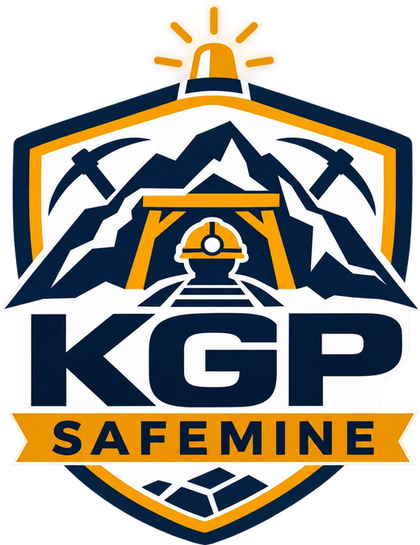
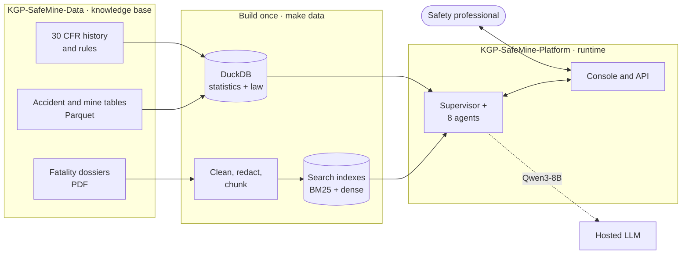

<div align="center">



# KGP-SafeMine

### Agentic AI for Mining Safety Incident Investigation

**An evidence-grounded AI assistant that turns decades of scattered US mining safety records into answers a safety professional can check, with a citation behind every claim.**


[The problem](#1-the-problem) ·
[The solution](#2-the-solution) ·
[Repository map](#3-repository-map) ·
[How it fits together](#4-how-the-two-parts-fit-together) ·
[Get started](#6-get-started) ·
[Trust and safety](#7-trust-and-safety)

</div>

> **Decision support only.** KGP-SafeMine produces drafts for a qualified safety professional to review. It is not legal, regulatory or
> engineering advice. It never assigns blame, certifies compliance or advises on a live emergency.

---

## 1. The problem

Mining is one of the few industries where lessons are written in hard-won detail. After every fatal accident, the US Mine Safety and
Health Administration (MSHA) publishes investigation reports, alerts and enforcement actions, and the rules themselves (Title 30 of the
Code of Federal Regulations, "30 CFR") change over the years. All of it is public. In practice, **almost none of it is usable at the
moment it is needed.**

| What a safety professional faces today | Why it hurts |
|---|---|
| **Hundreds of long PDF reports.** Root causes, corrective actions and citations sit deep inside narrative text | Finding "what went wrong in similar incidents" means reading, not searching |
| **Records, reports and regulation live in separate places.** Accident tables, inspection and violation data, investigation reports and 30 CFR have different formats | No single place answers "how often", "why" and "which standard" together |
| **The law changes over time.** A standard that applied on the day of an accident may read differently today | An answer that quotes today's text for yesterday's accident is wrong |
| **Generic AI chatbots guess.** They sound confident, invent citations and cannot show where a statement came from | In a safety setting, an unsupported claim is worse than no answer |
| **Sensitive content.** Reports mention victims, witnesses and employers | Careless tools expose names or assign blame they have no authority to assign |

The result: recurring causes go unnoticed, investigations start from a blank page, and the evidence that could prevent the next
accident stays buried.

## 2. The solution

**KGP-SafeMine is an agentic Retrieval-Augmented Generation (RAG) platform.** Instead of letting a language model answer from memory,
a team of cooperating agents *finds the evidence first*, writes an answer only from that evidence, and then *checks its own work*.

<table>
<tr>
<td width="33%" valign="top">

#### Ask in plain language
"What root causes did MSHA find for haul-truck fatalities at surface mines?"
"How many fatal accidents by classification?"
"What did 30 CFR 56.14211 require in 2019?"

</td>
<td width="33%" valign="top">

#### Get answers you can verify
Every factual sentence cites a report passage, a database figure or the regulation text. Quotes are checked word for word, and
numbers, dates and standards are checked against the cited evidence.

</td>
<td width="33%" valign="top">

#### Trust the "I don't know"
When evidence is missing the system abstains instead of guessing. It refuses blame, compliance verdicts and live-emergency advice,
and routes doubtful answers to a human reviewer.

</td>
</tr>
</table>

### What it delivers

| Capability | What it means for the user |
|---|---|
| **Incident investigation** | An evidence-backed brief for a named incident, with a timeline and the standards involved |
| **Root-cause patterns** | Recurring causes and corrective actions across many reports, with a note on how much evidence supports them |
| **Regulatory intelligence** | The text of a 30 CFR section *as it read on a given date*, plus search and compliance-oriented lookups |
| **Safety statistics** | Trends and counts from hundreds of thousands of accident records; the model picks a whitelisted metric and never writes SQL |
| **Similar past incidents** | Related events named by date and classification, grounded in the dossiers |
| **Governance built in** | Login, review queue (approve, flag, reject), DRAFT-marked exports, full traces of every question |

### Why this approach is different

1. **Evidence before language.** Hybrid search (keyword and meaning) with a re-ranker finds the passages; the model only writes
   around them.
2. **Eight specialised agents, one supervisor.** Safety, planner, retrieval, regulatory, investigation, validator, critic and report
   agents each do one job, and every hand-off is a recorded message.
3. **Verification that does not trust the model.** Deterministic checks remove unsupported sentences; a critic with a 60 % support
   floor decides whether to accept, revise or abstain.
4. **Fail-closed by design.** If any safety-critical step fails, the answer is an honest abstention, never an unchecked draft.
5. **Small model, serious engineering.** It runs on a hosted **8-billion-parameter model (Qwen3-8B, 8,192-token context)**, proving that
   retrieval, tool design and verification matter more than raw model size.

### Why it was created

KGP-SafeMine is a capstone project from the **Executive Post Graduate Programme in Generative AI and Agentic AI (IIT Kharagpur)**,
built for **Track B: a multi-agent system on a hosted model of at most 8B parameters**. The brief: *turn historical mining-incident
records into safety intelligence, with every statement traceable to a source.* The constraint is the interesting part. With no access to
model weights and no larger model, all quality had to come from retrieval, tool design, orchestration and evaluation, and each claim of
quality had to be measured, not asserted.

---

## 3. Repository map

This repository holds the two halves of the project: **the data** the system learns from and **the platform** that uses it.

```text
KGP-SafeMine-Agentic-AI-for-Mining-Safety-Incident-Investigation/
│
├── KGP-SafeMine-Data/        the knowledge base: a cleaned, de-duplicated, partly redacted MSHA snapshot
│
└── KGP-SafeMine-Platform/    the application: agents, tools, console, API, tests, evaluation, deployment
```

<table>
<tr>
<td width="50%" valign="top">

### 📚 [`KGP-SafeMine-Data/`](KGP-SafeMine-Data/)
**The knowledge base.** A cleaned snapshot of public MSHA data (30 October 2026) prepared for retrieval.

| Folder | Contents |
|---|---|
| `fatality_investigations/` | One PDF dossier per fatality event (2008 to 2026) and an events index; the main retrieval corpus |
| `structured_data/` | Accidents, mines, inspections, violations, production and orders (Parquet) for statistics |
| `regulations/` | 30 CFR (current and version history), Mine Act, Federal Register rules |
| `major_disaster_investigations/` | Long-form reports on major disasters |
| `policy_and_guidance/` | Program policy manual and handbooks |
| `reference_statistics/` | National fatality statistics for context |
| `processing_reports/` | Audit trail: disposition of every source file, checksums, known gaps |

Start with [`KGP-SafeMine-Data/README.md`](KGP-SafeMine-Data/README.md). The cleaning and chunking decisions are in
[`KGP-SafeMine-Platform/docs/DATA_AND_CHUNKING.md`](KGP-SafeMine-Platform/docs/DATA_AND_CHUNKING.md).

</td>
<td width="50%" valign="top">

### 🛡️ [`KGP-SafeMine-Platform/`](KGP-SafeMine-Platform/)
**The platform.** Everything needed to build, run and deploy the assistant.

| Part | Contents |
|---|---|
| `app/` | Streamlit console (nine pages, secure login) and FastAPI service |
| `safemine/` | Supervisor and eight agents, five tools, data pipeline, tracing |
| `tests/` | Unit, UI, login, prompt-injection and failure tests |
| `eval/` | 100-question golden benchmark and evaluation runners |
| `docs/` | Agents, data and chunking, injection defence, login, Docker, deployment |
| `observability/` | Optional self-hosted Langfuse tracing |
| Docker files | One image for console and API, non-root and hardened |

Start with [`KGP-SafeMine-Platform/README.md`](KGP-SafeMine-Platform/README.md) for the full architecture, how a question is
answered, setup and deployment.

</td>
</tr>
</table>

---

## 4. How the two parts fit together



1. **Data** is the curated source of truth: public MSHA material, cleaned and de-duplicated.
2. **Build** (run once, `make data`) turns it into search indexes and a database. It also redacts remaining personal names.
3. **Platform** answers questions at run time: it plans, retrieves, drafts, verifies and either answers with citations or abstains.

The data does **not** change when the platform runs, and the platform never writes answers back into the data.

### The data at a glance

| | |
|---|---|
| Fatality investigation dossiers | **655** (2008 to 2026) |
| Searchable report chunks | **10,990** |
| Accident records | **275,673** |
| Regulation records (30 CFR history) | **70,109** |
| Source files with an audit trail | **6,887** |
| Snapshot date | 30 October 2026 |

### Results in brief

Measured on a 100-question benchmark written before any agent code was built (14 for development, 86 frozen for the final test).

| Measure | Result |
|---|---|
| End-to-end accuracy on the frozen test split (Qwen3-8B) | **52 / 86 (60.5 %)** |
| Right investigation report in the top 10 search results | **100 %** (first place 96.2 %) |
| 30 CFR lookups (exact text, by title, by date) | **16 / 16** |
| Prompt-injection attacks planted in retrieved evidence | **124 / 126 held** |

Full tables, method and failure analysis are in the platform documentation.

---

## 5. Who it is for

| Audience | How KGP-SafeMine helps |
|---|---|
| **Mine safety and health professionals** | Start an investigation from evidence, find precedents, map findings to standards |
| **Safety trainers and analysts** | See recurring causes and trends behind incidents |
| **Regulatory and compliance staff** | Read a standard as it stood on a given date, with the source shown |
| **Students and researchers** | A worked example of agentic RAG with verification, abstention and honest evaluation |
| **Engineers adopting the pattern** | A complete reference: agents, tools, tests, observability and deployment |

---

## 6. Get started

### 1. Clone, including the large data files

Three data files are stored with [Git LFS](https://git-lfs.com). Install it first.

```bash
git lfs install
git config --global core.longpaths true        # Windows only: allows very long paths
git clone https://github.com/agnibeshSamanta1988/KGP-SafeMine-Agentic-AI-for-Mining-Safety-Incident-Investigation.git
cd KGP-SafeMine-Agentic-AI-for-Mining-Safety-Incident-Investigation
git lfs pull                                    # only if big files appear as small text pointers
```

### 2. Set up the platform

```bash
cd KGP-SafeMine-Platform
python -m venv .venv
.venv/bin/pip install -r requirements.txt       # Windows: .venv\Scripts\pip
cp .env.example .env                            # add your keys and endpoints
mkdir -p .streamlit && cp .streamlit/secrets.toml.example .streamlit/secrets.toml
.venv/bin/python -m app.make_password_hash      # paste the hash into .streamlit/secrets.toml
make models                                     # one-time model download
```

### 3. Build the search indexes from the data folder

The data sits one level up, next to the platform. Tell the pipeline where it is by adding one line to `KGP-SafeMine-Platform/.env`:

```bash
SAFEMINE_DATA=../KGP-SafeMine-Data
```

```bash
make data                                       # clean, chunk, DuckDB, BM25 + dense indexes
```

### 4. Run

```bash
.venv/bin/streamlit run app/ui.py               # console  http://localhost:8501
.venv/bin/uvicorn app.api:app --port 8000       # API docs http://localhost:8000/docs
```

Prefer containers? See [`KGP-SafeMine-Platform/docs/DOCKER.md`](KGP-SafeMine-Platform/docs/DOCKER.md) and
[`docs/DEPLOYMENT.md`](KGP-SafeMine-Platform/docs/DEPLOYMENT.md) for Docker, HTTPS and tracing.

> **What you must supply yourself:** API keys and endpoints (`.env`), a login hash (`secrets.toml`), and a chat and an embedding endpoint
> (Qwen3-8B and `bge-small-en-v1.5`; the embeddings can also run locally on CPU). No key, password or private data is included in this repository.

---

## 7. Trust and safety

| Concern | How KGP-SafeMine handles it |
|---|---|
| **Invented facts** | Citations are mandatory; quotes, numbers, dates and standards are verified against the cited evidence; unsupported sentences are removed |
| **Blame and legal verdicts** | Blocked: no fault, liability, compliance certification, predictions or "official" findings |
| **Live emergencies** | Refused; the platform is not an operational decision tool |
| **Prompt injection** | Eight defence layers, including screening of retrieved documents; tested with 126 planted attacks |
| **Personal data** | Victims replaced in the source data; a second pass redacts remaining names; an output filter blocks names |
| **Unverified answers** | Fail-closed abstention, a human-review queue and DRAFT-marked exports |
| **Access and secrets** | bcrypt login with lock-out; keys, certificates and data are mounted at run time and never baked into the Docker image |
| **Auditability** | Every question, plan, tool call and agent message is traced |

### Known limits, stated plainly

* An 8B model with an 8,192-token window summarises from selected passages, not whole dossiers.
* Only indexed sources are used; uploaded files are stored but not searched.
* Law answers are limited to the CFR editions that were collected.
* Name redaction is pattern-based and reduces, but cannot guarantee zero, exposure of personal names. Treat the PDFs as not fully anonymised.

### Data attribution

The data comes from public US Government sources (MSHA, the Code of Federal Regulations and the Federal Register). US Government works are
generally public domain, but images and some content may belong to others. Attribute MSHA and do not imply endorsement.

---

<div align="center">

**KGP-SafeMine** · evidence first, or no answer.

[Platform guide](KGP-SafeMine-Platform/README.md) · [Data guide](KGP-SafeMine-Data/README.md) · [Agents](KGP-SafeMine-Platform/docs/AGENTS.md) · [Deployment](KGP-SafeMine-Platform/docs/DEPLOYMENT.md)

</div>
